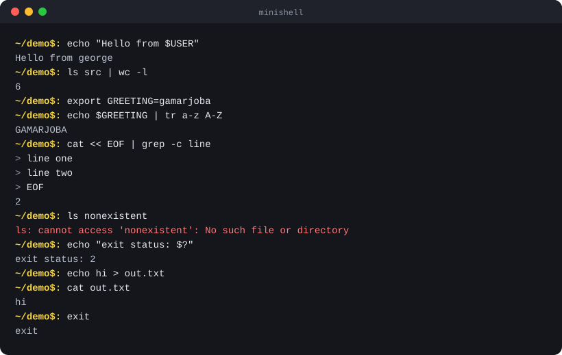
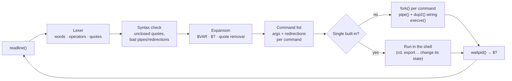

<div align="center">

# Minishell

**A small Unix shell in C, modelled on bash: pipes, redirections, heredocs, quotes, variables and signals.**




<sub>A real session: variables, pipes, a heredoc piped into <code>grep</code>, <code>$?</code> after an error, and an output redirection.</sub>

</div>

---

## What it is

Minishell reads a command line, works out what it means the way bash would, and runs it: starting processes, connecting them with pipes, redirecting their input and output, and reporting how they exited. Written from scratch in C, with no parsing libraries.

## Features

| | |
|---|---|
| **Prompt** | Shows the current directory; command history with the arrow keys (GNU Readline) |
| **Commands** | Programs found through `PATH`, or by relative or absolute path |
| **Pipes** | Any number of commands chained with `\|` |
| **Redirections** | `<` input, `>` output, `>>` append, `<<` heredoc |
| **Quotes** | `'single'` keeps everything literal; `"double"` still expands variables |
| **Variables** | `$NAME` from the environment and `$?` for the last exit status |
| **Built-ins** | `echo -n`, `cd`, `pwd`, `export`, `unset`, `env`, `exit` |
| **Signals** | `Ctrl-C` new prompt, `Ctrl-D` exit, `Ctrl-\` ignored, like bash in interactive mode |

## How it works



A few things that make it harder than it looks:

- **Built-ins that change the shell** (`cd`, `export`, `unset`, `exit`) must run in the shell process itself, not in a child, unless they are part of a pipeline.
- **Every process must close every pipe end it doesn't use**, or the reader never sees end-of-file and the pipeline hangs.
- **Heredocs** are read before anything runs, and `Ctrl-C` must cancel them cleanly.
- **Signals behave differently** at the prompt, inside a heredoc and while a child is running, just like in bash.

## What it took

| Area | Details |
|---|---|
| **Parsing** | A hand-written lexer and parser with bash's quoting and expansion rules |
| **Processes** | `fork`, `execve`, `waitpid`, exit statuses and `PATH` resolution |
| **File descriptors** | `pipe`, `dup2`, `open` and closing every descriptor in every process |
| **Signals** | `signal`/`sigaction` handlers that switch with the shell's state |
| **Correctness** | Matching bash's behaviour and error messages on edge cases |
| **C** | Manual memory management with no leaks over a long-running process |

## Project structure

```
src/
├── Parsing/          tokens, command groups, redirections
├── Parsing_Word/     quotes and variable expansion inside words
├── Parsing_Errors/   syntax errors with bash's messages
├── EXECUTION/        pipelines, redirections, heredocs, PATH lookup
├── Commands/         built-ins: echo, cd, pwd, export, unset, env, exit
└── Others/           main loop, signals, cleanup
libft/                my own C standard library
```

## Build and run

Requires GNU Readline (`libreadline-dev` on Debian/Ubuntu).

```bash
git clone https://github.com/francuza9/Minishell.git && cd Minishell
make
./minishell
```

---

<div align="center"><sub>École 42 common core project by <a href="https://tskdev.org">George Tskitishvili</a></sub></div>
